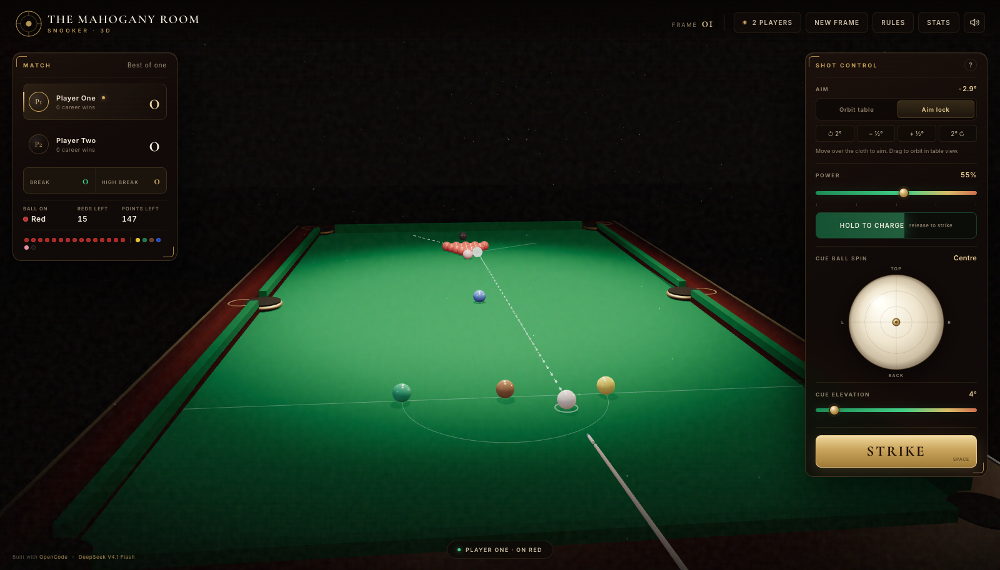
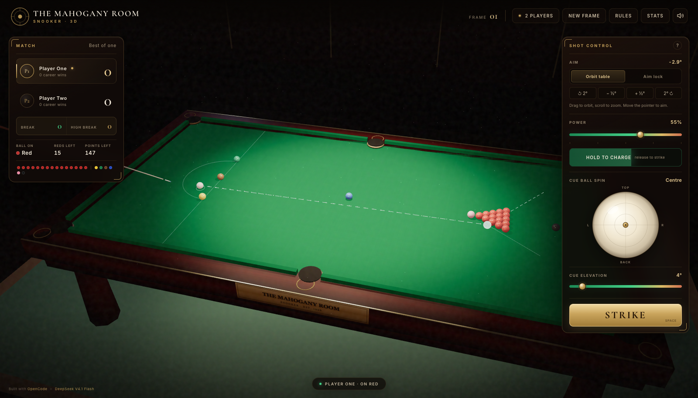
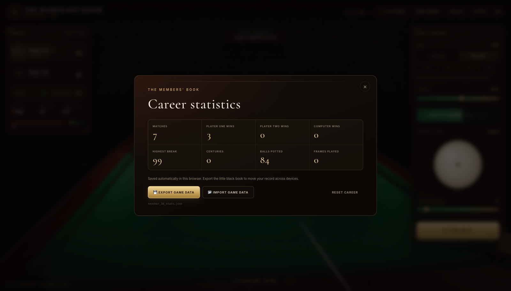
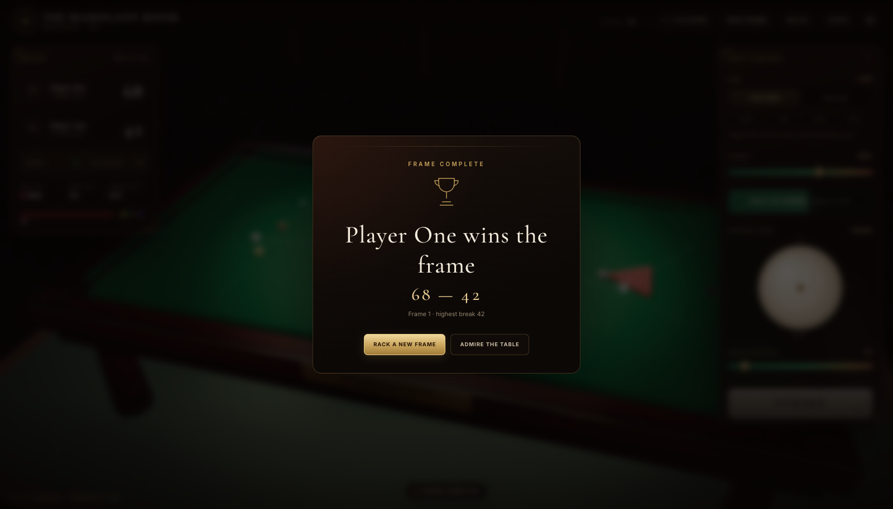
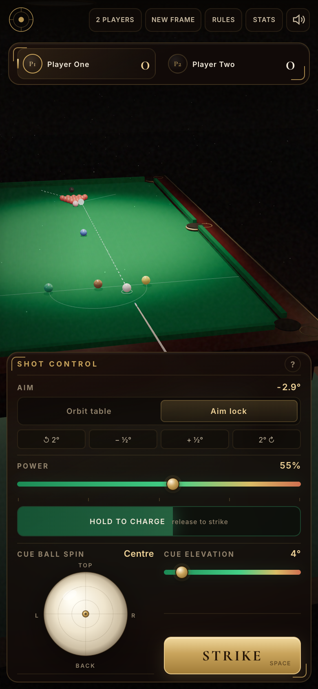

# The Mahogany Room · 3D Snooker

A complete, single-table **3D snooker game** in the browser. Twenty-two balls, real cushion physics, cue-ball spin, a referee who knows the rules, a computer opponent, and a career book you can carry between devices.



**Live demo:** <https://somphol.github.io/snooker-3d/>

## Play

The game is entirely static — no build step, no server-side code, no API keys.

```sh
git clone https://github.com/somphol/snooker-3d.git
cd snooker-3d
python3 -m http.server 8000
# then open http://localhost:8000
```

You can also open `index.html` directly, though some browsers are stricter about local files. Three.js, OrbitControls and Cannon.js are loaded from public CDNs, so the first load needs an internet connection. Everything else — the table, texture generation, audio, rules, AI and styling — lives in the three source files.

## What is in the box

- **A full 12 ft × 6 ft table** at correct proportions: mahogany frame, brass pocket rims, baize cloth, six pocket drop holes, baulk line, the D, and all six colour spots.
- **All 22 balls**: cue ball, 15 reds racked in a triangle, and yellow, green, brown, blue, pink and black on their proper spots.
- **Real rigid-body physics** with Cannon.js: sphere–sphere momentum transfer, cushion restitution, cloth friction, rolling resistance and pocket capture.
- **Aim like a player**: a dotted cue path, a ghost ball at first contact, a target-ball line and a cue-ball deflection line. The guide turns amber when the first ball is not on.
- **Two camera styles**: a low *Aim lock* view behind the cue ball, or a free *Orbit table* view for reading the whole rack.
- **Power, spin and elevation**: slider or hold-to-charge stroke meter, a draggable cue-ball contact dot for follow, screw and left/right english, and a cue elevation control for gentle jump/masse shots.
- **A referee**: alternates reds and colours, enforces the clearance order, respots colours, detects scratches, wrong-ball first contact, misses and illegal pots, and awards 4–7 point penalties.
- **Two-player or AI**: the computer chooses pots by ghost-ball geometry, falls back to a safe contact, and plays with a little human error.
- **A career book** in `localStorage`: matches, wins, highest break, centuries, total pots and frames. Export `snooker_3d_stats.json` and import it on another machine.
- **Responsive layout**: a full desktop club-room HUD, a compact portrait layout, and a wide-angle mobile camera.
- **Synthesised audio** for cue strikes, ball clicks, cushion thuds, pocket drops and fouls — no sound files to download.

## How to play

Snooker in one paragraph: pot a red (1 point), then any colour (2–7 points). Colours are respotted while reds remain. When all fifteen reds are gone, clear the colours in order — yellow, green, brown, blue, pink, black. A legal pot keeps you at the table. A miss passes the turn. A foul gives your opponent at least four points. The maximum break is 147.

The HUD always shows the ball on, the reds left, the points left, the current break and your career high break.

### Controls

| Input | Action |
| --- | --- |
| Move the pointer over the cloth | Aim the cue ball |
| Left-drag (Orbit table) | Orbit the camera |
| Mouse wheel / pinch | Zoom |
| **Aim lock** / **Orbit table** | Switch camera style |
| Aim nudge buttons or `←` / `→` | Fine-tune by 0.5° (`Shift` = 2°) |
| Power slider | Set a precise shot power |
| Hold **Hold to charge** or `Space`, then release | Charge and strike |
| Drag the dot on the cue-ball face | Apply follow, screw or side spin |
| Cue elevation slider | Raise the cue butt for jump/masse shots |
| `A` / `O` | Aim lock / orbit |
| `R` | Centre the spin dot |
| **New frame** | Rack a fresh frame |

The dotted line is the cue ball's path. The wireframe sphere is the ghost ball at first contact. The thin gold line is where the object ball will go; the faint white line is the cue ball's tangent. If the first ball is not the ball on, the guide glows amber.

### Spin, in practice

- **Top (follow):** the cue ball keeps travelling forward after contact.
- **Back (screw):** the cue ball checks up and comes back.
- **Right/left english:** the cue ball curves a little through the cloth and reacts differently off cushions.
- **Elevation:** above about 18° the cue lifts the cue ball slightly off the cloth. It is a small hop, not a full jump shot.

## The referee

The engine tracks the ball on as `red`, `colour`, or a specific clearance colour. It checks the first ball contacted by the cue ball, then the balls potted on that stroke. It handles:

- legal reds (including several reds in one stroke),
- a colour after a red, with the colour respotted,
- the free-colour phase after the last red,
- the clearance order and a respotted black tie-break,
- scratches, misses, wrong-ball-first fouls and illegal pots,
- minimum four-point penalties up to seven,
- turn changes, break totals and career high breaks.

Colours are respotted on their own spot, then on the highest available spot, then on the nearest free point along the centre line. A scratched cue ball is replaced inside the D.

## The career book

Stats are written to `localStorage` under `snooker3d_stats_v1` and survive reloads in the same browser.

**Export game data** downloads `snooker_3d_stats.json`:

```json
{
  "app": "snooker-3d",
  "version": 1,
  "exportedAt": "2026-10-31T23:00:00.000Z",
  "stats": {
    "version": 1,
    "matchesPlayed": 7,
    "framesPlayed": 8,
    "wins": { "p1": 3, "p2": 1, "ai": 2 },
    "highBreak": 99,
    "centuries": 0,
    "totalPots": 84,
    "updatedAt": "2026-10-31T23:00:00.000Z"
  }
}
```

**Import game data** reads either that wrapper or a bare stats object, validates every field and replaces the local book. The export/import flow is tested with a real downloaded file.

## Under the hood

| Layer | Details |
| --- | --- |
| Rendering | Three.js r128, physically based materials, ACES filmic tone mapping, PCF soft shadows, procedural canvas cloth/wood/floor textures |
| Physics | Cannon.js 0.6.2, 120 Hz fixed step with sub-stepping, SAP broadphase, 24 solver iterations |
| Table | 3.569 m × 1.778 m playing area, 52.5 mm balls, 4.5 in pockets, baulk line 0.737 m from the baulk cushion, 0.292 m D |
| Aim | 2D ray/circle intersection on the cloth plane; ghost ball, target and tangent lines |
| Rules | Pure-ish `resolveShot()` referee function with an explicit ball-on state |
| AI | Ghost-ball pot search over every legal target and pocket, path checks, pocket-based power, a safe-contact fallback and small aiming error |
| Persistence | `localStorage` with a versioned, sanitised JSON schema |
| Audio | Web Audio oscillators and a generated noise buffer; no media assets |

The renderer draws the table in metres. The cue ball is 26.25 mm in radius, the pocket jaws are built from six cushion boxes, and pocket capture is checked against the actual mouth positions every frame. Rolling deceleration is applied on top of Cannon's damping so the balls settle like cloth, not ice.

### File map

```text
index.html              the club-room HUD and game shell
style.css               mahogany/brass design system and responsive layout
script.js               Three.js scene, Cannon physics, referee, AI, UI
favicon.svg             the house crest
screenshot*.png         rendered stills used by this README
state.json              build duration and OpenCode token accounting
STATE.md                human-readable build record
LICENSE                 MIT
THIRD_PARTY_NOTICES.md  library and font attribution
```

## More views

| Orbit the table | The members' book |
| --- | --- |
|  |  |

| Frame complete | Portrait layout |
| --- | --- |
|  |  |

## Credits

Built in a single agent session with **[OpenCode](https://opencode.ai)** and **DeepSeek V4.1 Flash** (`opencode-go/deepseek-v4.1-flash`).

The game, table geometry, procedural textures, physics tuning, referee, AI, HUD, responsive layout and documentation were generated for this project. Build time and token usage are recorded in [STATE.md](STATE.md) and [state.json](state.json).

Third-party libraries: [Three.js](https://threejs.org/) by mrdoob and contributors (MIT), [Cannon.js](https://schteppe.github.io/cannon.js/) by Stefan Hedman and contributors (MIT), [OrbitControls](https://threejs.org/docs/#examples/en/controls/OrbitControls) (MIT), and the Google Fonts **Cormorant Garamond** and **Inter** families (SIL Open Font License). See [THIRD_PARTY_NOTICES.md](THIRD_PARTY_NOTICES.md).

## License

MIT © 2026 Somphol Boonjing. See [LICENSE](LICENSE).
